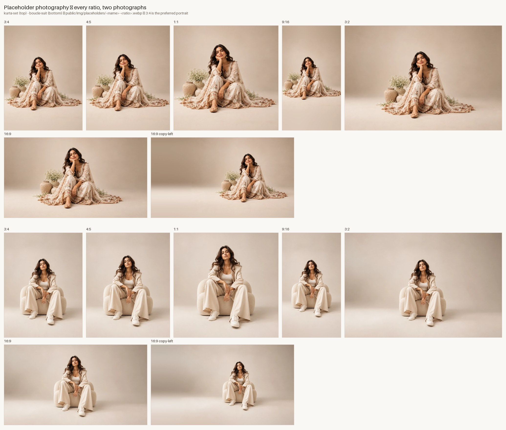

# Nykaa Fashion — grid & layout system

One grid, used everywhere. Every image, card, banner and text block lines up on it, and every page picks a *composition* for its
content instead of repeating one pattern. This file is the contract; `scripts/qa/grid.cjs` enforces the alignment part on the
rendered DOM and `scripts/qa/flat.cjs` enforces the visual rules.

## 0. Identity — what stays Nykaa Fashion

The redesign keeps the live brand and reorganises it; it does not invent a new one.

| Kept from the live site | How it shows up |
| --- | --- |
| White surfaces, slate text, **navy primary buttons**, **raspberry accent `#982854`**, **green savings**, **blue labels** | tokens in `globals.css`: `navy` = Add to Bag / Proceed to Buy, `pink` (the name is historical) = the raspberry for links, active underlines, badges and headline emphasis (`<em>`), `emerald` = discount % and savings, `blue` = "Responsible" / "Exclusive" labels, `maroon` = login band. The hot-pink `brand` `#FC2779` appears only in the supplied wordmark (`public/brand/nykaa-fashion-logo.svg`, inlined by `Logo`) |
| Navigation | one main row — wordmark · Women · Men · Kids · Home · **More** (poster tiles: Luxe Edit, Hidden Gems, Responsible, Festive & Wedding, House of Nykaa, Style Files) · search · **Fashion \| Luxe** switch · Account / Wishlist / Cart — and under it the **department row** (What’s New, Sale, then categories; dropdowns open with "Shop All" in raspberry; hovering a department previews its row); a thin black utility strip (Track order, Help) above; phones: ☰ drawer + search field, bottom nav Home · Shop · Brands · Wishlist · Bag |
| Homepage module stack | sale banner → category tiles → **Celebration-ready categories** → **Iconic brands, unreal savings** → **Build Diwali wardrobe** → curated destinations → SEO copy (titles as on the live page; counts and "up to X% off" stamps are computed from the catalogue) |
| Listing pattern | brand (bold) → product name (grey) → price + struck MRP + **green** "% off"; wishlist heart top-right; "House of Nykaa" badge on own labels; filter and size chips are pills |
| Brand names | H&M, Puma, U.S. Polo Assn., Cider, Vero Moda and the House of Nykaa labels (Twenty Dresses, Nykd, RSVP, Pipa Bella, Gajra Gang, Likha) — **sample listings**, flagged as such |
| Footer | black "Download our app" + helpline strip → link strip (Who are we · Help · Quicklinks · Follow us) → six-column directory (Women · Men · Kids · Luxe · Top Brands · House of Nykaa, two grid columns each); entries that the sample catalogue cannot back are left out, never dead-ended |
| Dialogs | login modal with a maroon band and the white wordmark; bag drawer with Price Summary, savings banner and a sticky "Proceed to Buy" bar; size guide as a right-hand drawer |

What changes is structure: one grid, a different composition per section, clearer hierarchy and spacing, flat and shadow-free.

## 1. Rules of the look

| Rule | What it means in code |
| --- | --- |
| **One typeface — Inter Display** | Inter's variable font (weight 100–900, `opsz` 14–32), self-hosted from `public/fonts` via `@font-face` in `globals.css` (no font CDN at build or run time); `body { font-variation-settings: "opsz" 32 }` selects the Display optical size. `--font-sans/-display/-mono` all point at it. Headings are weight 700, tightly tracked; emphasis (`<em>`) is upright and takes the raspberry accent — never italic, never a second family. No `font-mono`, `font-serif`, `font-display` utilities in components. |
| **No shadows, anywhere** | No `shadow-*`, `ring-*`, `drop-shadow`, `text-shadow`, `backdrop-blur`, `filter`. (The live site lifts dropdowns and drawers with shadows; here they get a 1px border — an explicit requirement.) Focus is a 2px outline. Overlays are separated by a 1px ink line + a flat `bg-ink/50` scrim. Tailwind's `ring` is a box-shadow — do not use it. |
| **Flat colour** | Solid fills from the token palette. No gradients (not even scrims over photos — put text on a flat panel or on a calm area of the image), no grain, no blend modes. |
| **Corners** | Controls take the live site’s 4px (a base rule on `button, input, select, textarea`); size chips, filter chips and toggles are pills (`rounded-full`); dialogs 16px; images, cards and tiles stay square. Circles by nature: avatars, colour swatches, hot-spot pins, radio buttons, count badges. |
| **Hairlines** | 1px `border-line` for structure, `border-ink` for emphasis. Structure comes from borders and whitespace, not elevation. |

## 2. Tokens (`src/app/globals.css`)

| Token | Value | Notes |
| --- | --- | --- |
| `--maxw` | `1600px` | content max width (`container-x`) |
| `--gutter` | `clamp(16px, 3.2vw, 48px)` | page side padding |
| `--gap` | `16px` <600 · `20px` ≥600 · `24px` ≥1024 | the *only* gap between grid columns and between neighbouring tiles |
| `--edge` | `max(--gutter, (100vw − --maxw)/2 + --gutter)` | distance from the viewport edge to the content edge — use it to bleed a block off the screen while keeping its other edge on the grid |
| `--section-y` | `clamp(56px, 7vw, 112px)` | vertical rhythm between sections |
| `--header-h` | measured from the header at runtime (≈109px ≥1024 with the department row, 104px below; the CSS value is the first-paint default) | sticky offsets (`--header-offset` follows the hide-on-scroll header) |
| `--bottom-nav-h` | 60px | phones: bottom navigation (hidden on PDP and checkout) |

## 3. Columns

* **4 columns below 600px**, **12 columns from 600px up** (`grid-main`). Column gap is `--gap`.
* Three layout steps: *phone* (`base`, 4 cols), *tablet* (`sm`, ≥600, 12 cols), *desktop* (`lg`, ≥1024, 12 cols).
* Spans that compose cleanly on 12: `6+6`, `4+4+4`, `3+3+3+3`, `8+4`, `7+5`, `9+3`, `2×6`. On phones: `4`, `2+2`, `1+3`.
* **Nested grids**: inside a `span-N` block, use `grid-cols-N` with `gap-x-[var(--gap)]` — the sub-columns then land exactly on the page's columns (N equal columns + the same gap = N columns of the parent). Never hand-pick `gap-5`/`gap-8` between aligned things.
* **Carousels** size items from `--pv` (items per view): `calc((100% − (pv−1)·gap)/pv)`. With `pv = 4` at ≥1024 each card is exactly `span-3`; `pv = 6` ⇒ `span-2`; `pv = 3` ⇒ `span-4`; `pv = 2` ⇒ `span-6`. Phones use fractional `pv` (2.25, 1.15 …) so the next card peeks.
* **Full-bleed blocks** (hero, banners, split sections): either both edges on the viewport, or *one* edge on a column line and the other on the viewport (`lg:-mr-[var(--edge)]` / `-mx-[var(--gutter)]`). Never an arbitrary x.

## 4. Primitives

| Primitive | File | Use |
| --- | --- | --- |
| `Grid`, `Col` | `layout/Grid.tsx` | `<Grid><Col span={{ base: 2, sm: 6, lg: 3 }} start={{ lg: 7 }} rowStart={{ lg: 1 }} rows={{ lg: 2 }} /></Grid>`. Always give a `rowStart` when you give a `start`, otherwise auto-placement drifts past the tile and leaves a hole. |
| `Section` | `layout/Section.tsx` | Full-width flat band (`tone` = bone / paper / white / sand / ink / luxe / gem / resp / festive / pink-tint), vertical rhythm `y="md" \| "sm" \| "none"`, content in `container-x` (or `bleed`). |
| `SectionHeading` | `ui/SectionHeading.tsx` | Eyebrow + title (cols 1–6) and intro / link / arrows (cols 7–12, or `splitAt={7}` for a 7/5 layout). `size="md" \| "lg" \| "xl"`. |
| `PageHeader` | `layout/PageHeader.tsx` | Breadcrumbs + `SectionHeading level 1`. First thing on every page below the header. |
| `Carousel`, `CarouselTrack`, `CarouselArrows` | `ui/Carousel.tsx` | Horizontal rail with density presets (`product` 4-up, `tile` 6-up, `wide` 3-up, `feature` 2-up). Arrows live in the heading (desktop only; touch swipes; the track is a focusable scroll region). |
| `BentoTile` | `ui/BentoTile.tsx` | Image + flat caption strip. `ratio="fill"` takes the height of the rows it spans (give its parent `relative` and `aspect-*`/rows). |
| `ProductCard` | `product/ProductCard.tsx` | 4:5 image, label, name, price (discount only when real). `fill` stretches the image to the height the grid gives (feature cards). |
| `Img` | `ui/Img.tsx` | The only way to render a picture: average-colour placeholder, `ratio`, `ratio="fill"`, `load` hints. |

## 5. Composition catalogue

Pick one per section; do not repeat the same one twice in a row on a page.

1. **Full-bleed banner** — image edge to edge, copy on a calm area (or flat panel below on phones). *Home hero.*
2. **Bento 6 + 2×2** — one 6-column tile spanning 2 rows beside four 3-column tiles; mirror it left/right between sections. *Categories, edits.*
3. **Carousel 4-up / 6-up** — product or tile rail, arrows in the heading. *New in, picked for you, more from this label.*
4. **Mixed-size product grid** — one 6-column × 2-row feature card + 3-column cards. *Trending, listing inserts.*
5. **Split banner** — flat colour panel (cols 1–6) + image bleeding off the right edge (cols 7–12). *Festive.*
6. **Lead + stack** — 7-column lead story beside two compact stories (5 columns). *Style Files.*
7. **Panel + 2 features** — 4-column text panel and two 4-column product cards. *Label spotlight.*
8. **Uniform 4-up product grid** — `span-3` cards, `gap-y` 40px. *Listings, wishlist.*
9. **Sidebar layouts** — 6/6 (PDP: a nested 6-col gallery — thumbnail rail in col 1, picture in cols 2–6, sticky — beside the info column in cols 7–12), 8/4 (bag | summary), 7/5 (checkout), 3/9 (account nav | content). The bag is also a right-hand drawer, the login a centred modal.
10. **Editorial rows** — alternate 6/6, 4/4/4, 7/5, 5/7 and full-width image rows so no two consecutive rows share a rhythm. *Discover, story pages.*
11. **Shoppable scene + list** — an 8-column scene with hot-spot pins beside a 4-column list of the pieces in it (rows stretch to the image height; on tablets the list becomes three span-4 cards under the scene). *Shop the look, story pages.*

## 6. Page map

| Page | Structure |
| --- | --- |
| Home | Sale banner carousel (3 slides, pause + arrows) → price shortcuts → category tiles (6-up carousel) → offers for you (coupon tiles) → Celebration-ready categories (4 portrait tiles) → Iconic brands (4×2 brand wall) → Build Diwali wardrobe (4-col photo feature + 2×4 tiles) → new-arrivals carousel → curated destinations bento (mirrored) → trending mixed grid → shop-the-look scene + list → Style Files (lead + stack) → House of Nykaa spotlight → SEO accordion → service promises → footer. Order adapts to intent (cold / returning / deal). |
| Category / search / edit / label listings | Page heading → sub-category tile rail → sticky toolbar (Filter · quick chips · count · Sort) → full-width 4-up grid (3-up tablet, 2-up phone) with a 6×2 feature insert → "Show more". Filters open in a drawer so the grid keeps all 12 columns. |
| Product | Gallery 8 cols (image grid: first image 8, then 4+4; phones: swipeable, full bleed) + sticky buy box 4 cols → details / delivery / reviews (4+8) → complete-the-look carousel → more-from-label carousel. Sticky add-to-bag bar on phones. |
| Discover / stories | Asymmetric editorial rows; article = full-bleed cover, 7-column reading column (cols 3–9 / centred), wide shoppable images spanning 12 or 8+4. |
| Edits index / Labels A–Z / Offers | Bento of edits · A–Z rail (col 1) + 3 label columns · coupon tiles 3-up. |
| Bag / checkout / confirmation | 8/4, 7/5, 6/6 with a sticky summary. Simulated payment always labelled. |
| Account / login | 3/9 shell (nav | content); login 6/6 (image | form). |

## 7. Navigation

* **Top (desktop ≥1024)** — row 1: logo (cols 1–3) · search (4–9) · Account / Wishlist / Bag (10–12). Row 2: Edits, Discover, Women, Men, Kids, Home (mega menus on a 3+3+3+3 grid) · New in, Offers. Hides on scroll down, returns on scroll up.
* **Top (<1024)** — ☰ menu drawer · logo · account, then a full-width search field. The drawer holds departments, edits, labels, help, prototype controls.
* **Bottom (<1024)** — Home · Shop (category sheet) · Edits · Wishlist · Bag, with live counts; hidden on the product page and checkout.
* Keyboard: `/` opens search, `Esc` closes any overlay, focus is trapped and restored in every dialog/drawer.

## 8. Audits

```
node scripts/qa/grid.cjs  http://localhost:3200 [--routes /,/c/women] [--widths 390,820,1280,1728]   # images sit on column lines
node scripts/qa/flat.cjs  http://localhost:3200 [--routes …] [--widths …] [--overlays]               # no shadow / gradient / blur / non-Inter font
node scripts/qa/overflow.cjs http://localhost:3200                                                    # no horizontal overflow
```

## 9. Imagery

Every image on the site is cut from the two supplied studio photographs (see README → Imagery). They are cut into every ratio the layouts use, so a slot never has to crop a mismatched image:

| Ratio | File suffix | Use |
| --- | --- | --- |
| 3:4 (preferred portrait) | `-3x4` | category, edit and story cards |
| 4:5 | `-4x5` | product-style cards, bento tiles, phone hero |
| 1:1 | `-1x1` | square tiles, collection thumbnails |
| 16:9 | `-16x9` | wide banners, split sections |
| 16:9, subject right | `-16x9-copy-left` | desktop hero — headline sits on the calm left wall |
| 9:16 | `-9x16` | stories, vertical promos |
| 3:2 | `-3x2` | the untouched original |



Files: `public/img/placeholders/{kurta-set,boucle-suit}-<ratio>.webp`; typed keys and the slot → ratio guide are in `src/data/placeholders.ts`.
Portrait and vertical ratios extend the seamless studio backdrop (edge colour + a damped copy of its own gradient + matched grain — never the subject);
regenerate with `npm run photo:ratios` (sources in `scripts/placeholders/source/`; `--jpg <dir>` also writes JPGs). Every other key (product views, category / edit / story scenes, the auth panel) is cut at its own size by `npm run photo:fill`, and `npm run photos` does both. To use real photography, replace a file with a
photograph of the same name (and re-measure `edge`/`pins` in `image-meta.json` if the slot uses them).
