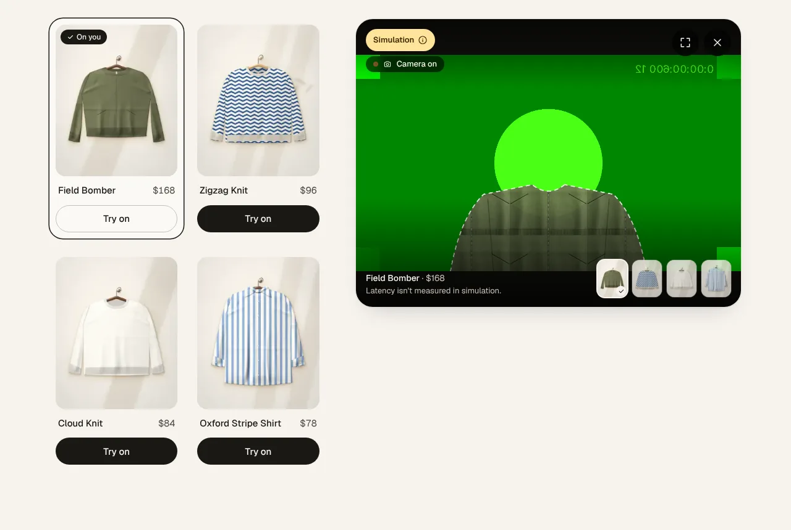
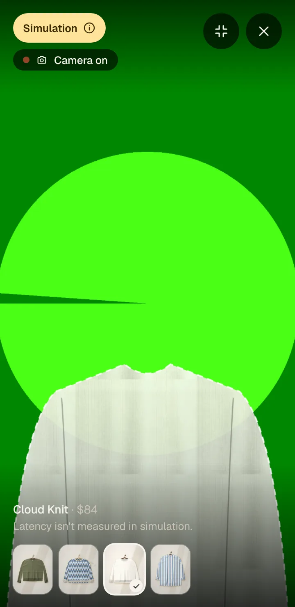

# Live AI Virtual Try-On — demo

A standalone Next.js demo of **live, camera-based virtual try-on**: a shopper clicks **Try on**, sees the garment on their own moving camera feed, and switches pieces **without the camera restarting**. Built from the PRD "Live AI Virtual Try-On Clothing Site".

> **Local / private review only. No public deploy.** Sample products, no cart, no checkout, no accounts, and no video or photo is ever stored.

The try-on panel is the product. The shop around it is a thin frame. The panel is a reusable `<TryOn>` component behind a provider adapter, so going live is a config switch, not a rebuild.

| Consent, before any camera | Live (Simulation shown) | Phone, fullscreen |
| --- | --- | --- |
|  |  |  |

*Screenshots are Simulation mode with a fake camera device (the green frame is Chromium's test pattern). The dashed garment shape is a deliberately crude placeholder, labelled as such. It is not AI output.*

## Run it

```bash
npm install
npm run dev          # http://localhost:3000
```

That's it. **With no key it runs in Simulation mode**: your real camera, a deliberately crude garment-shaped placeholder, and an unmissable **Simulation** badge. Nothing leaves your browser tab. Camera access needs `https://` or `localhost`.

```bash
npm test             # 104 tests: state machine, controller, Decart adapter, config, catalogue, contrast
npm run typecheck && npm run lint
npm run build && npm start
```

## Going live (needs a Decart key)

Live mode uses Decart's realtime Virtual Try-On model (`lucy-vton-3.6`) over WebRTC through the official `@decartai/sdk`.

1. Create an account and an API key at <https://platform.decart.ai> (new accounts get free credits to test; there is no free-forever production tier).
2. Copy the env template and put the key in **`.env.local`** (gitignored; never paste a key into chat, a commit, or a `NEXT_PUBLIC_*` variable):

   ```bash
   cp .env.example .env.local
   # edit .env.local  ->  DECART_API_KEY=dct_...
   ```

3. Restart. The **Simulation** badge disappears and the consent copy switches to the live wording.

**What it costs.** Decart bills per second of active generation. The pricing page lists a VTON realtime model at about **$0.02/sec at 720p** (≈ $1.20/min; `speed:"fast"` is 2×). The pricing page and the model docs disagree on the model name (`lucy-2.1-vton` vs `lucy-vton-3.6`), so **confirm the rate against your own account before quoting a number.** Guardrails ship on by default: sessions end after **180 s** (server-side on the token and client-side in the panel), the panel connects only after consent + camera permission, and Close, a hidden tab, or leaving the page hard-stops everything.

| Env var (server only) | Default | What it does |
| --- | --- | --- |
| `DECART_API_KEY` | – | Permanent key. Never leaves the server. Absent → Simulation. |
| `TRYON_MODE` | live if keyed, else sim | `sim` forces Simulation even with a key (no billing). |
| `TRYON_MODEL` | `lucy-vton-3.6` | Pinned on purpose; `lucy-vton-3.5` / `lucy-vton-latest` also accepted. |
| `TRYON_MAX_SESSION_SECONDS` | `180` | Session cap. `0` disables both caps. |
| `TRYON_FAST` | off | `1` → `speed:"fast"` (lower connect latency, 2× billing). |

The mode is read from server env **at request time**, so one build serves either mode.

## How it fits together

```
 page (server)  ──resolveConfig()──▶  mode · model · cap          (never a secret)
      │
 <TryOnDemo> ── garment cards ── ref.tryOn(id) ──▶ <TryOn>        reusable component
                                                       │
                                            TryOnController        camera + session + teardown
                                  pure reducer (machine.ts)  ·  epoch-guarded async
                                                       │
                              ┌── TryOnProvider ───────┴──────────────┐
                    SimulationProvider                        DecartProvider
                    canvas overlay, no network                lazy @decartai/sdk, WebRTC
                                                                      │  apiKeyProvider (every connect / reconnect)
                                                              POST /api/token ──▶ Decart: tokens.create()
                                                              (server holds dct_ key; returns a ~60 s token)
```

- **State machine** (`src/components/tryon/machine.ts`): the PRD's eight states and every transition row, as a pure reducer.
- **Controller** (`controller.ts`): opens the camera only after consent, discards any async result from a session that was already closed (a late "Allow" after Close is switched straight back off), queues garment swaps (leading edge, last selection wins, always the **complete** garment), and tears down in a fixed order: invalidate async work → stop tracks synchronously → disconnect.
- **Adapter** (`providers/`): `SimulationProvider` and `DecartProvider` implement one interface, so `<TryOn>` cannot tell them apart.
- **Garment switch correctness:** Decart's `set()` replaces the entire state, so `setGarment()` always sends `{prompt, image, enhance:false}` together. This is a test (`tests/decart.test.ts`).
- **Token route** (`src/app/api/token/route.ts`): mints and returns a token, nothing else. No logging of keys or tokens, same-origin only, 10 s timeout, a server-side session-length cap on the token.

## Reuse `<TryOn>` in a real storefront

```tsx
import { TryOn, DecartProvider, type TryOnHandle } from "@/components/tryon";

const provider = useMemo(() => new DecartProvider({ model: "lucy-vton-3.6" }), []);
const tryOn = useRef<TryOnHandle>(null);

<button onClick={(e) => tryOn.current?.tryOn(product.id, e.currentTarget)}>Try on</button>
<TryOn ref={tryOn} garments={products} provider={provider} maxSessionSeconds={180} onEvent={track} />
```

`<TryOn>` takes a product list and a provider and runs. It imports nothing from the demo page or the demo's data. To let desktop shoppers drag a card onto it, spread `garmentDragProps(id)` on the card.

## Swap the catalogue

Edit **`src/data/garments.ts`**, nothing else. Each product is `{ id, name, price, image, prompt }`:

- `image`: a **garment-only** photo on a plain background, ≥ 512×512, in `public/garments/`. Not on-model.
- `prompt`: 20–30 words, "Substitute/Add …" pattern, concrete about colour, fabric, neckline and how it's worn. Garment quality depends on it. `npm test` enforces the word count.

The four sample images are generated by the parent repo's art engine (`scripts/garments.manifest.json`). They are fictional and stand in for real photography.

## Privacy, honestly

- **Live mode:** camera frames **are sent to Decart** over WebRTC, transformed by the model, and streamed back. **Processing is not local.** Decart's privacy policy covers streaming session data and permits using it to improve their products. Decart's public docs do not state a frame-retention window for realtime try-on, and this demo does not claim one. **Confirm retention (and any no-training term) with Decart in writing before any non-demo use.**
- **Simulation:** no network request carries camera frames. The "stays in this browser tab" wording is only used there, and only because that is true.
- **This site stores nothing:** no recording, no upload, no saved frames. We do not persist a consent flag either — consent is asked at the start of every camera session, because every session is a new transmission.
- **Consent is its own step**, before the browser's camera prompt. Browser permission alone is not informed consent.
- **Kill switch:** Close (×), Esc, leaving the tab, hiding the tab, or unmounting stops every camera track and tears down the session. A "camera on" indicator is visible whenever the camera is active.

## Tests

```bash
npm test                                                       # unit + contract tests, no browser
npm run build && npm start -- -p 3200                          # a build with NO key  (Simulation)
DECART_API_KEY=dct_dummy npm start -- -p 3201                  # same build, DUMMY key (live UI + token failure path)
node scripts/qa/checklist.cjs http://localhost:3200 http://localhost:3201 --out qa-output
```

`scripts/qa/checklist.cjs` is the PRD's test checklist as an executable run in headless Chromium with a fake camera (needs Playwright; `npm i --no-save axe-core` adds the accessibility pass). The dummy key is rejected by Decart, which is exactly how it proves the failure path without spending anything. See [`docs/TEST_CHECKLIST.md`](docs/TEST_CHECKLIST.md) for results and [`docs/DELIVERY_NOTE.md`](docs/DELIVERY_NOTE.md) for what is and isn't verified.

## Known limits

- **Real model output is unverified here.** No key was available, so lag, drape, arm tracking and live latency have not been observed. See the delivery note's "validate with a key" list.
- Simulation does not track your body: the placeholder is fixed. That is deliberate, and labelled.
- WebRTC needs a capable device and a decent uplink; a degraded network is a designed state (hint, then error + Retry), not something to hide.
- iOS Safari needs a real-device pass (fullscreen uses a fixed overlay because iPhone has no element fullscreen).
- Effectively single-provider for this capability today, which is why it sits behind `TryOnProvider`.
