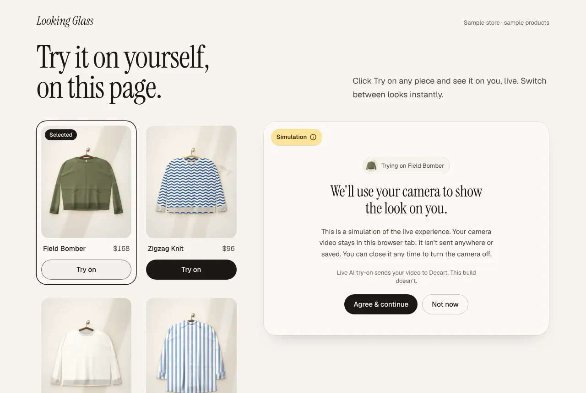
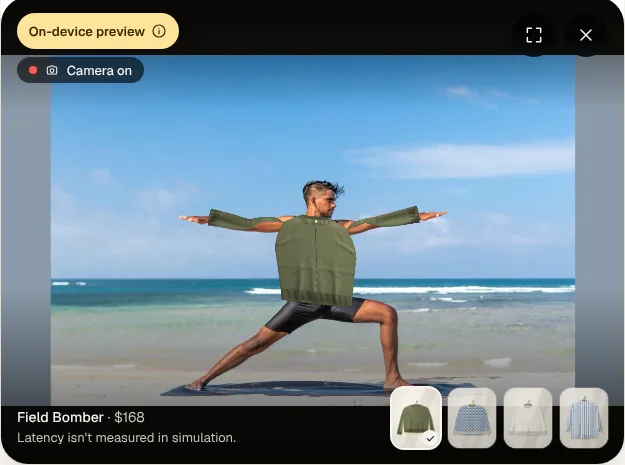
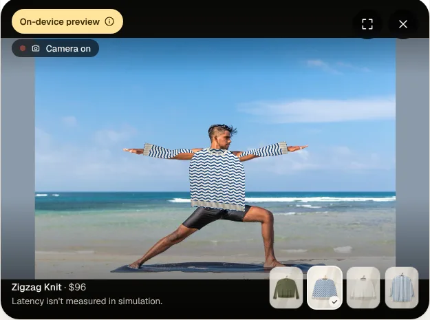

# Live AI Virtual Try-On — demo

A standalone Next.js demo of **live, camera-based virtual try-on**: a shopper clicks **Try on**, sees the garment on their own moving camera feed, and switches pieces **without the camera restarting**. Built from the PRD "Live AI Virtual Try-On Clothing Site".

> **Local / private review only. No public deploy.** Sample products, no cart, no checkout, no accounts, and no video or photo is ever stored.

The try-on panel is the product. The shop around it is a thin frame. The panel is a reusable `<TryOn>` component behind a provider adapter with two engines:

| | **On-device preview** (default) | **Live AI** (optional) |
| --- | --- | --- |
| What draws the garment | Body tracking in your browser warps a rigged image of the garment onto your shoulders, arms and torso | Decart's Lucy VTON model renders real fabric on your moving body |
| Follows your movement | Yes: turns, raised arms, crossed arms | Yes |
| Looks like real fit and drape | **No.** A flat image on your joints, labelled "On-device preview" | Yes |
| Where your video goes | **Nowhere.** No server, no third-party request, works offline | To Decart over WebRTC |
| Needs | Nothing | A Decart API key, billed per second |

| Consent, before any camera | On-device preview, arms out | On-device preview, switched |
| --- | --- | --- |
|  |  |  |

*Screenshots from headless Chromium with a photo of a person as the fake camera (MediaPipe's public pose test image). The garment is the tracker's warped image, not AI output; the Live AI mode has not been captured because it needs a key.*

## Run it

```bash
npm install
npm run dev          # http://localhost:3000
```

That's it. **With no key it runs the on-device preview**: your real camera, the garment following your body, and an unmissable **On-device preview** badge. Nothing leaves your browser tab. Camera access needs `https://` or `localhost`.

```bash
npm test             # 140 tests: state machine, controller, Decart adapter, warp maths, body mapping, photo client, config, catalogue, contrast
npm run typecheck && npm run lint
npm run build && npm start
```

## On-device preview: how it works

Everything runs in the browser, from files served by this app (`public/models/mediapipe`, 36 MB: the MediaPipe WASM runtime, a pose model and a skin segmenter). No CDN, no third party, no upload.

1. **Pose.** MediaPipe Pose finds 33 body landmarks per frame.
2. **Rig.** Each garment is three transparent images, torso and two sleeves, with anchor points: neck, shoulder seams, torso sides, hem corners, sleeve tips, elbows, cuffs (`src/data/garments.ts`).
3. **Torso.** A thin-plate-spline warp pins the torso's anchors to the body. The body decides *where* (shoulders, hips, lean); the garment keeps its *own* width, so a boxy sweater stays boxy instead of collapsing onto the hip joints.
4. **Sleeves.** Each sleeve is skinned to a two-bone arm (shoulder tip → elbow → wrist), so a raised arm rotates the whole sleeve. Arms that aren't visible let the sleeve hang. A sleeve draws in front of the torso when the wrist is closer to the camera than the shoulders.
5. **Hands.** When a hand crosses the torso, skin pixels (from the segmenter) are drawn back on top inside a circle around the wrist.
6. **Compositing.** WebGL draws the warped parts; a 2D canvas composites them over the camera frame and feeds the panel's video. Garment switches cross-fade in place.

What it deliberately is not: fit, drape, fabric, or occlusion by anything but hands. It is honest about that in the badge, the consent step and the footer. If the models or WebGL fail to load, the panel falls back to the fixed silhouette placeholder, labelled **Simulation**.

**Adding a garment.** The four sample rigs are generated from the parent repo's art engine by `scripts/make-cutouts.mjs` (it renders each piece into its own film, so the body keeps the pixels under the sleeve heads, and measures the anchors). For real photography: cut the photo into the same three transparent parts in Figma, drop them in `public/garments/parts/`, and write the part boxes and anchors into `src/data/garments.ts` as fractions of the full cutout. `npm test` checks they're sane.

## Photo mode: a realistic still on your own GPU

The tracker shows the interaction; it can't show fit. For a real render without any cloud, run the render server on a machine with an NVIDIA GPU (8 GB+), using FASHN VTON 1.5 (Apache-2.0). Setup is in [`server/README.md`](server/README.md). Then:

```
TRYON_PHOTO_URL=http://192.168.1.50:8000
```

in `.env.local`, restart, and the live panel gets **See it properly**: hold still, one camera photo and the garment image go to that server, and 5–20 s later the still shows over the live view, labelled with the model and the time it took. The live session keeps running; Esc or "Back to live" returns. Nothing is stored anywhere; the still is an in-memory blob. `python server/tryon_server.py --mock` fakes the server for wiring tests; its results are stamped and labelled "Mock render".

The plan for taking this further (dressed clips, then toward real-time) is in [`docs/PLAN_GENERATIVE_TRYON.md`](docs/PLAN_GENERATIVE_TRYON.md).

## Going live (needs a Decart key)

The on-device preview shows the interaction; it can't show real fit. For that, Live mode uses Decart's realtime Virtual Try-On model (`lucy-vton-3.6`) over WebRTC through the official `@decartai/sdk`, which is the model behind the reference video.

1. Create an account and an API key at <https://platform.decart.ai> (new accounts get free credits to test; there is no free-forever production tier).
2. Copy the env template and put the key in **`.env.local`** (gitignored; never paste a key into chat, a commit, or a `NEXT_PUBLIC_*` variable):

   ```bash
   cp .env.example .env.local
   # edit .env.local  ->  DECART_API_KEY=dct_...
   ```

3. Restart. The **On-device preview** badge disappears and the consent copy switches to the live wording.

**What it costs.** Decart bills per second of active generation. The pricing page lists a VTON realtime model at about **$0.02/sec at 720p** (≈ $1.20/min; `speed:"fast"` is 2×). The pricing page and the model docs disagree on the model name (`lucy-2.1-vton` vs `lucy-vton-3.6`), so **confirm the rate against your own account before quoting a number.** Guardrails ship on by default: sessions end after **180 s** (server-side on the token and client-side in the panel), the panel connects only after consent + camera permission, and Close, a hidden tab, or leaving the page hard-stops everything.

| Env var (server only) | Default | What it does |
| --- | --- | --- |
| `DECART_API_KEY` | – | Permanent key. Never leaves the server. Absent → on-device preview. |
| `TRYON_MODE` | live if keyed, else sim | `sim` forces the on-device preview even with a key (no billing). |
| `TRYON_MODEL` | `lucy-vton-3.6` | Pinned on purpose; `lucy-vton-3.5` / `lucy-vton-latest` also accepted. |
| `TRYON_MAX_SESSION_SECONDS` | `180` | Session cap. `0` disables both caps. |
| `TRYON_FAST` | off | `1` → `speed:"fast"` (lower connect latency, 2× billing). |
| `TRYON_PHOTO_URL` | – | Your still-image render server. Adds the "See it properly" button. |

The mode is read from server env **at request time**, so one build serves either mode.

## How it fits together

```
 page (server)  ──resolveConfig()──▶  mode · model · cap          (never a secret)
      │
 <TryOnDemo> ── garment cards ── ref.tryOn(id) ──▶ <TryOn>        reusable component
                                                       │
                                            TryOnController        camera + session + teardown
                                  pure reducer (machine.ts)  ·  epoch-guarded async
                                                       │
                 ┌────────────── TryOnProvider ───────┴──────────────┐
         LocalPoseProvider (default)                          DecartProvider
         MediaPipe pose + skin segmenter, self-hosted          lazy @decartai/sdk, WebRTC
         rig: torso TPS + two-bone sleeves, WebGL
         (falls back to SimulationProvider: fixed silhouette)
                                                                      │  apiKeyProvider (every connect / reconnect)
                                                              POST /api/token ──▶ Decart: tokens.create()
                                                              (server holds dct_ key; returns a ~60 s token)
```

- **State machine** (`src/components/tryon/machine.ts`): the PRD's eight states and every transition row, as a pure reducer.
- **Controller** (`controller.ts`): opens the camera only after consent, discards any async result from a session that was already closed (a late "Allow" after Close is switched straight back off), queues garment swaps (leading edge, last selection wins, always the **complete** garment), and tears down in a fixed order: invalidate async work → stop tracks synchronously → disconnect.
- **Adapter** (`providers/`): `LocalPoseProvider`, `SimulationProvider` and `DecartProvider` implement one interface, so `<TryOn>` cannot tell them apart. The tracker's maths (`providers/local/tps.ts`, `skin.ts`, `pose-map.ts`) is pure and unit-tested in Node; only `localPose.ts` and `gl-mesh.ts` touch the browser.
- **Garment switch correctness:** Decart's `set()` replaces the entire state, so `setGarment()` always sends `{prompt, image, enhance:false}` together. This is a test (`tests/decart.test.ts`).
- **Token route** (`src/app/api/token/route.ts`): mints and returns a token, nothing else. No logging of keys or tokens, same-origin only, 10 s timeout, a server-side session-length cap on the token.

## Reuse `<TryOn>` in a real storefront

```tsx
import { TryOn, DecartProvider, type TryOnHandle } from "@/components/tryon";

const provider = useMemo(() => new DecartProvider({ model: "lucy-vton-3.6" }), []);
const tryOn = useRef<TryOnHandle>(null);

<button onClick={(e) => tryOn.current?.tryOn(product.id, e.currentTarget)}>Try on</button>
<TryOn ref={tryOn} garments={products} provider={provider} maxSessionSeconds={180} onEvent={track} />
```

`<TryOn>` takes a product list and a provider and runs. It imports nothing from the demo page or the demo's data. To let desktop shoppers drag a card onto it, spread `garmentDragProps(id)` on the card.

## Swap the catalogue

Edit **`src/data/garments.ts`**, nothing else. Each product is `{ id, name, price, image, prompt }`:

- `image`: a **garment-only** photo on a plain background, ≥ 512×512, in `public/garments/`. Not on-model.
- `prompt`: 20–30 words, "Substitute/Add …" pattern, concrete about colour, fabric, neckline and how it's worn. Garment quality depends on it. `npm test` enforces the word count.

The four sample images are generated by the parent repo's art engine (`scripts/garments.manifest.json`). They are fictional and stand in for real photography.

## Privacy, honestly

- **Live mode:** camera frames **are sent to Decart** over WebRTC, transformed by the model, and streamed back. **Processing is not local.** Decart's privacy policy covers streaming session data and permits using it to improve their products. Decart's public docs do not state a frame-retention window for realtime try-on, and this demo does not claim one. **Confirm retention (and any no-training term) with Decart in writing before any non-demo use.**
- **On-device preview:** no network request carries camera frames; the models themselves are served from this app's own origin. The "stays in this browser tab" wording is only used there, and only because that is true.
- **This site stores nothing:** no recording, no upload, no saved frames. We do not persist a consent flag either — consent is asked at the start of every camera session, because every session is a new transmission.
- **Consent is its own step**, before the browser's camera prompt. Browser permission alone is not informed consent.
- **Kill switch:** Close (×), Esc, leaving the tab, hiding the tab, or unmounting stops every camera track and tears down the session. A "camera on" indicator is visible whenever the camera is active.

## Tests

```bash
npm test                                                       # unit + contract tests, no browser
npm run build && npm start -- -p 3200                          # a build with NO key  (Simulation)
DECART_API_KEY=dct_dummy npm start -- -p 3201                  # same build, DUMMY key (live UI + token failure path)
node scripts/qa/checklist.cjs http://localhost:3200 http://localhost:3201 --out qa-output
```

`scripts/qa/checklist.cjs` is the PRD's test checklist as an executable run in headless Chromium with a fake camera (needs Playwright; `npm i --no-save axe-core` adds the accessibility pass; `ffmpeg` enables the tracker checks, which feed a photo of a real person to the fake camera and verify the garment is drawn and switched on the body). The dummy key is rejected by Decart, which is exactly how it proves the failure path without spending anything. See [`docs/TEST_CHECKLIST.md`](docs/TEST_CHECKLIST.md) for results and [`docs/DELIVERY_NOTE.md`](docs/DELIVERY_NOTE.md) for what is and isn't verified.

## Known limits

- **Real model output is unverified here.** No key was available, so lag, drape, arm tracking and live latency have not been observed. See the delivery note's "validate with a key" list.
- **The on-device preview is an approximation and has only been driven by photos in headless Chromium**, never by a real webcam on a real device. Frame rate on real hardware is unmeasured (expected: smooth on a laptop, usable on a recent phone). Turning sideways narrows the garment but can't show its side; nothing but hands occludes it; the shirt's big sleeve caps read as caps when arms are raised.
- WebRTC needs a capable device and a decent uplink; a degraded network is a designed state (hint, then error + Retry), not something to hide.
- iOS Safari needs a real-device pass (fullscreen uses a fixed overlay because iPhone has no element fullscreen).
- Effectively single-provider for this capability today, which is why it sits behind `TryOnProvider`.
